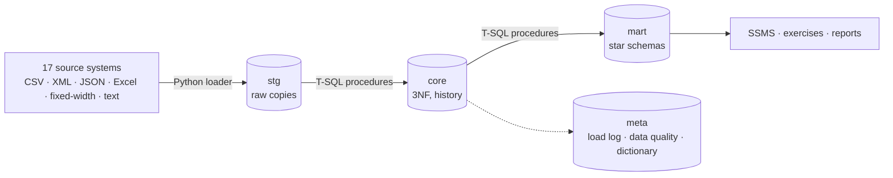

# KV Simulation - a training data warehouse for a Kassenärztliche Vereinigung

A small but realistic SQL Server project that simulates the data landscape of a
**Kassenärztliche Vereinigung (KV)**, the regional association of statutory-health-insurance
physicians and psychotherapists in Germany. The region is the real **KV Saarland**
(6 Kreise, 52 Gemeinden); all doctors, practices, patients and amounts are **synthetic**.

The goal is to learn the *ideal way* to organise heterogeneous data: land it, integrate it,
model it, secure it, check it and query it - with theory notes and an exercise path from
`SELECT` to execution plans and data modelling.



## What is inside

| Domain | Content (reference build, seed 20250101) |
|---|---|
| Region | 6 Kreise with population by age group and sex (approximate), coordinates |
| Arztregister | 1,789 doctors/psychotherapists, 1,022 practices (710 Einzelpraxen, 285 BAG, 27 MVZ), 1,793 Teilnahmen with status history |
| Zulassung & Bedarfsplanung | 7 planning areas, 10 physician groups, 165 Versorgungsgrade (3 Stichtage), 126 Zulassungsverfahren |
| Abrechnung & Honorar | 4 quarters of 2025: 11,994 cases (a sample), 25,309 billing lines, 3,593 Honorarbescheide, 10,779 advance payments |
| Versorgung | 1,500 Terminservice requests, 3,480 out-of-hours shifts in 6 Bereitschaftspraxen |
| QS & Prüfungen | 825 QS permits, CME points 2021-2025, 135 audit procedures |
| Verordnungen | 4,664 aggregated prescription records + Richtgrößen |
| Kommunikation | 355 documents (enquiries, complaints, minutes, notices) linked to doctors/practices/procedures |

## Quick start

Prerequisites (all present on this machine): SQL Server 2019+ (here: 2025 Standard
Developer, default instance), SSMS, Python 3.12+, Microsoft ODBC Driver 18.

```powershell
# once: Python environment inside the project folder
py -3.13 -m venv .venv            # or: <path to python.exe> -m venv .venv
.venv\Scripts\python.exe -m pip install -r requirements.txt

# complete rebuild: generate sources, create all objects, load, check (~20 s)
powershell -ExecutionPolicy Bypass -File tools\run_all.ps1
```

Then open SSMS, connect to `localhost`, database `KVSim`, and start with
`SELECT * FROM core.v_teilnahme_aktuell;` or `SELECT * FROM mart.v_versorgung_aktuell;`.

## Run it step by step (recommended once, to understand the flow)

1. `.venv\Scripts\python.exe python\generate_sources.py` - writes `data/sources/` (look at the files!)
2. In SSMS, open and run (F5) the scripts in `sql/00_setup` … `sql/85_fulltext` in numeric order
   (see [sql/README.md](sql/README.md)).
3. `.venv\Scripts\python.exe python\load_staging.py` - fills `stg`, logs to `meta.load_file`.
4. In SSMS: `EXEC core.usp_load_all;` → `EXEC mart.usp_load_all;` → `EXEC meta.usp_run_dq_checks;`
5. `.venv\Scripts\python.exe python\export_data_dictionary.py` - refreshes `docs/data_dictionary.md`.
6. Tests: `.venv\Scripts\python.exe -m pytest`

## Folder structure

```text
health_association_simulation/
├── README.md                  you are here
├── config/settings.toml       DB connection, random seed, volumes, inject_dq_issues (off)
├── data/sources/              17 simulated source systems, each with a README (origin, owner, quirks)
├── docs/
│   ├── reading_map.md         guided tour for beginners, with diagrams
│   ├── architecture.md        layers, flow, domains, what is left out
│   ├── er_diagrams.md         Mermaid ER diagrams (core + mart)
│   ├── data_dictionary.md     every table and column (generated from the database)
│   ├── glossary.md            German KV terms explained in English
│   ├── assumptions.md         every assumption, to verify at the real KV
│   ├── design_decisions.md    why this key, this normal form, this load strategy (DD-01 …)
│   ├── naming_conventions.md
│   ├── security.md            roles: who may see what
│   ├── data_quality_report.md results of the 18 DQ rules
│   └── concepts/              one theory note per phase, tied to this project's tables
├── python/
│   ├── kvsim/                 generator (one consistent world), writers, loader, config
│   ├── generate_sources.py    → data/sources
│   ├── load_staging.py        → stg
│   └── export_data_dictionary.py
├── sql/                       numbered, re-runnable T-SQL scripts (see sql/README.md)
│   ├── 00_setup … 85_fulltext build the database
│   ├── 90_exercises/          exercise path, 4 levels
│   └── 91_solutions/          solutions (try first!)
├── tests/                     pytest: check digits, reproducibility, consistency of the world
└── tools/run_all.ps1          complete rebuild
```

## Learning path

New to SQL or to this project? Start with the [reading map](docs/reading_map.md): a guided tour with diagrams.

| Step | Read | Look at | Try in SSMS |
|---|---|---|---|
| 1 Layers & ELT | [concepts/01](docs/concepts/01_layers_and_elt.md) | `sql/00_setup`, `sql/10_meta` | `SELECT * FROM meta.load_step;` |
| 2 Sources & privacy | [concepts/02](docs/concepts/02_sources_and_privacy.md) | `data/sources/*/README.md` | open a CSV, the XML, the Excel file |
| 3 Staging & lineage | [concepts/03](docs/concepts/03_staging_and_lineage.md) | `sql/20_stg`, `python/kvsim/loader.py` | `SELECT TOP 20 * FROM stg.verordnung_zeilen;` |
| 4 Normalisation & keys | [concepts/04](docs/concepts/04_normalization_and_keys.md) | `sql/30_core`, `sql/40_core_load` | database diagram of arzt/teilnahme/praxis |
| 5 History & time | [concepts/05](docs/concepts/05_history_and_time.md) | `core.teilnahme_status` | `SELECT * FROM core.fn_teilnahme_am('2025-06-30');` |
| 6 Indexes & plans | [concepts/06](docs/concepts/06_indexes_and_plans.md) | index comments in `sql/30_core` | Ctrl+M, `SET STATISTICS IO ON` |
| 7 Star schema & SCD2 | [concepts/07](docs/concepts/07_star_schema_and_scd2.md) | `sql/50_mart`, `sql/60_mart_load` | `SELECT * FROM mart.v_fallwert_praxis_quartal;` |
| 8 Text & full-text | [concepts/08](docs/concepts/08_text_and_fulltext.md) | `core.dokument` | `sql/85_fulltext` |
| 9 Quality & security | [concepts/09](docs/concepts/09_quality_and_security.md) | `sql/70_quality`, `sql/80_security` | `EXECUTE AS USER = 'u_zulassung';` |
| 10 Exercises | [sql/90_exercises/README.md](sql/90_exercises/README.md) | levels 01 → 04 | compare with `sql/91_solutions` |

## Conventions in one minute

- Schemas `stg` / `core` / `mart` / `meta`; lower_snake_case; German business terms, English technical terms.
- Core: surrogate key `<table>_id` + UNIQUE business key; codes as `CHAR`; history as `[valid_from, valid_to)` with `9999-12-31` = open.
- Mart: `dim_` / `fact_`, `<dim>_key`, unknown member `-1`, `dim_arzt` is SCD type 2.
- Every script re-runnable; every load step logged; every table described in the database itself.

Details: [naming_conventions.md](docs/naming_conventions.md), [design_decisions.md](docs/design_decisions.md).

## Simplified on purpose (first version)

Billing is a sample (euro amounts are tiny, ratios realistic); Hausärzte are planned per
Kreis; one Fachgruppe and one practice per doctor at a time; no Nebenbetriebsstätten;
simplified EBM points and Honorarverteilung. All listed in
[assumptions.md](docs/assumptions.md) and [architecture.md](docs/architecture.md#deliberately-left-out-in-this-first-version).
The optional "data-quality injection" phase is **off** (`inject_dq_issues = false`) and not built yet.
