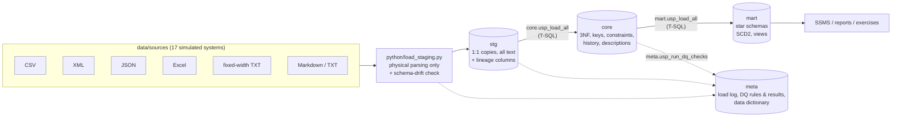

# Architecture

## Goal

Many unrelated source systems deliver data in different formats. The data warehouse
(`KVSim` database) turns them into **one consistent, documented, queryable model** without
losing the link to where each value came from.

## Layers

| Layer | Purpose | Rules | Load strategy | Who may read |
|---|---|---|---|---|
| `stg` | Landing zone, exactly what the source delivered | all business columns NVARCHAR, no constraints, lineage columns `load_batch_id`, `source_file`, `source_row_nr` | truncate + insert per load | ETL only |
| `core` | The integrated truth | 3NF, surrogate + business keys, PK/FK/UNIQUE/CHECK, valid-time history, descriptions | master data: upsert; transaction data: delete + reload per quarter | departments, per role |
| `mart` | Easy, fast reporting | star schemas, denormalised dimensions, unknown member `-1`, SCD2 for doctors | dimensions: upsert (stable keys); facts: full rebuild | departments, controlling |
| `meta` | Operation and governance | load log, DQ catalogue and results, data dictionary view | kept across rebuilds | ETL, DWH team |

## ELT, not ETL

Python only does what SQL Server cannot do conveniently from a user folder: read files in
many formats and insert them unchanged (see DD-02 in [design_decisions.md](design_decisions.md)).
**All business transformation is T-SQL** in stored procedures (`sql/40_core_load`,
`sql/60_mart_load`). That is ELT: Extract, Load, then Transform inside the database. The
logic stays in one language, close to the data and visible in SSMS.

## Load process

1. `python/load_staging.py` opens a batch (`meta.usp_batch_start`), truncates and fills
   every `stg` table, logs each file with row count and SHA-256 (`meta.load_file`), and
   closes the batch as `OK` or `FAILED`.
2. `EXEC core.usp_load_all;` runs eight procedures in dependency order. Each one is a
   single transaction, logs itself in `meta.load_step`, and is **idempotent**: running it
   twice gives the same result.
3. `EXEC mart.usp_load_all;` empties the facts, upserts the dimensions, and rebuilds the facts.
4. `EXEC meta.usp_run_dq_checks;` runs 18 data-quality rules (`meta.v_dq_latest`).

`tools/run_all.ps1` does all of this, plus creating every object, in about 20 seconds.

## Domains and where they live

| Domain | Core tables | Mart |
|---|---|---|
| Region | `kreis`, `einwohner`, `altersgruppe` | `dim_region`, `dim_altersgruppe` |
| Arztregister | `arzt`, `fachgruppe`, `praxis`, `kooperationsform`, `teilnahme`, `teilnahmeform`, `teilnahme_status` | `dim_arzt` (SCD2), `dim_praxis`, `dim_fachgruppe` |
| Zulassung & Bedarfsplanung | `arztgruppe`, `planungsbereich`, `planungsbereich_kreis`, `versorgungsgrad`, `zulassungsverfahren`, `zulassungsverfahren_status` | `fact_versorgungsgrad`, `dim_planungsbereich`, `dim_arztgruppe` |
| Abrechnung & Honorar | `quartal`, `krankenkasse`, `kassenart`, `ebm_kapitel`, `gop`, `orientierungswert`, `icd10`, `scheinuntergruppe`, `abrechnungsfall`, `leistung`, `fall_diagnose`, `honorarbescheid`, `abschlagszahlung` | `fact_leistung`, `fact_abrechnungsfall`, `fact_honorar_quartal`, `dim_gop`, `dim_krankenkasse`, `dim_quartal`, `dim_datum` |
| Versorgung | `tss_fachgebiet`, `tss_anfrage`, `notfallpraxis`, `bereitschaftsdienst` | `fact_tss_anfrage`, `fact_bereitschaftsdienst` |
| QS & Prüfungen | `qs_bereich`, `qs_genehmigung`, `fortbildungspunkte`, `pruefverfahren` | (exercises query core) |
| Verordnungen | `verordnung`, `richtgroesse` | (exercises query core) |
| Kommunikation | `dokumenttyp`, `dokument`, `dokument_bezug` | - |

Entity-relationship diagrams: [er_diagrams.md](er_diagrams.md). Every column:
[data_dictionary.md](data_dictionary.md).

## Deliberately left out in this first version

The project was scaled down to get a complete pipeline first. Natural next steps:

- Nebenbetriebsstätten (secondary sites) and doctors with several Fachgruppen (exercise 04)
- Mittelbereiche as Hausarzt planning areas, Gemeinde-level AGS
- Vertragsarztsitz as its own entity (seat that survives a succession)
- full Honorarverteilung (RLV/QZV), Heilmittel by therapy area, ATC drug groups
- row-level security per Bezirksstelle (sketched as exercise 04), dynamic data masking
- the optional data-quality injection phase (`inject_dq_issues`)
