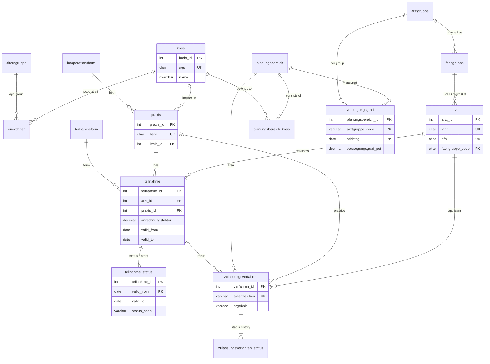
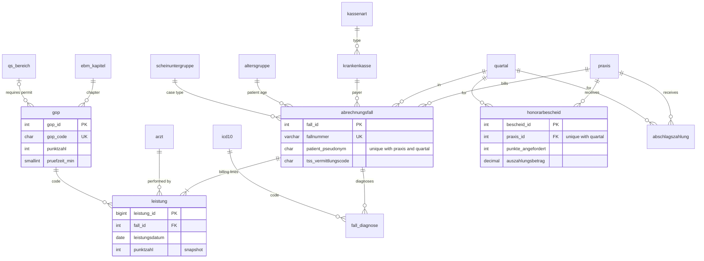
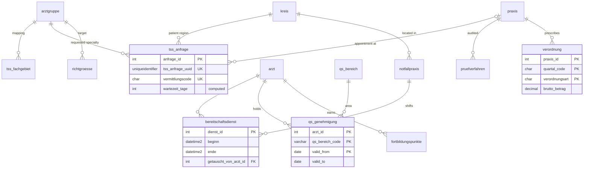
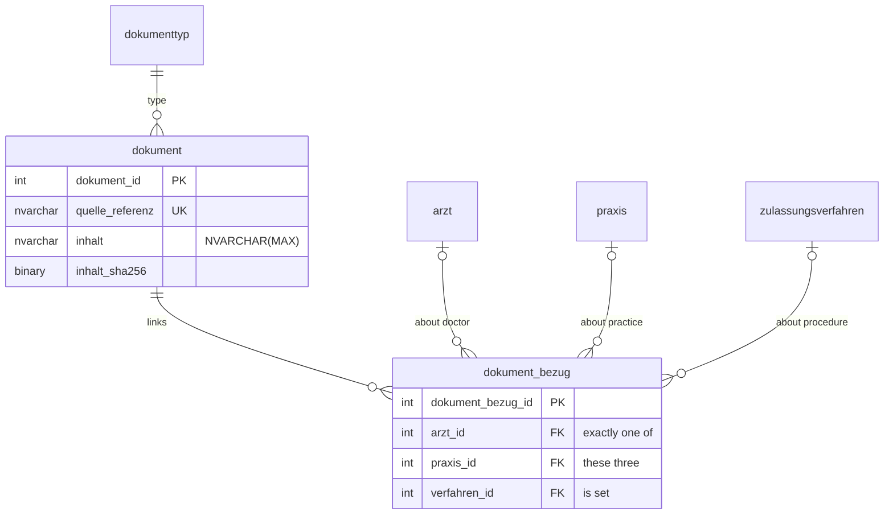
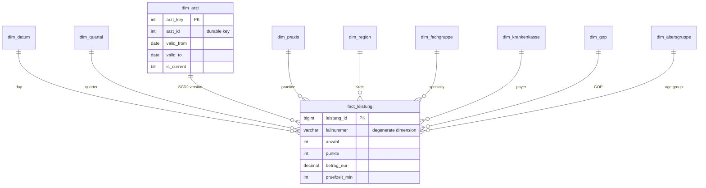

# Entity-relationship diagrams

Mermaid diagrams (rendered by GitHub, VS Code with a Mermaid extension, or
<https://mermaid.live>). Only key columns are shown; see [data_dictionary.md](data_dictionary.md)
for all columns. Notation: `||--o{` = one to zero-or-many, `||--|{` = one to one-or-many,
`|o--o{` = zero-or-one to zero-or-many (optional foreign key).

## 1. Region, Arztregister, Bedarfsplanung, Zulassung

## 2. Abrechnung and Honorar

## 3. Versorgung, Qualitätssicherung, Prüfung, Verordnung

The TSS request and the billing case are connected through the `vermittlungscode`
(a business key, not a foreign key: the two sources are independent systems).

## 4. Kommunikation (text)

## 5. Mart: star schema for billing

The other stars follow the same pattern:

| Fact | Dimensions |
|---|---|
| `fact_abrechnungsfall` | quartal, praxis, region, arzt, fachgruppe, krankenkasse, altersgruppe |
| `fact_honorar_quartal` | quartal, praxis, region |
| `fact_versorgungsgrad` | datum (Stichtag), planungsbereich, arztgruppe |
| `fact_tss_anfrage` | datum **twice** (request and appointment: a role-playing dimension), arztgruppe, region, altersgruppe, praxis |
| `fact_bereitschaftsdienst` | datum, arzt, region |
