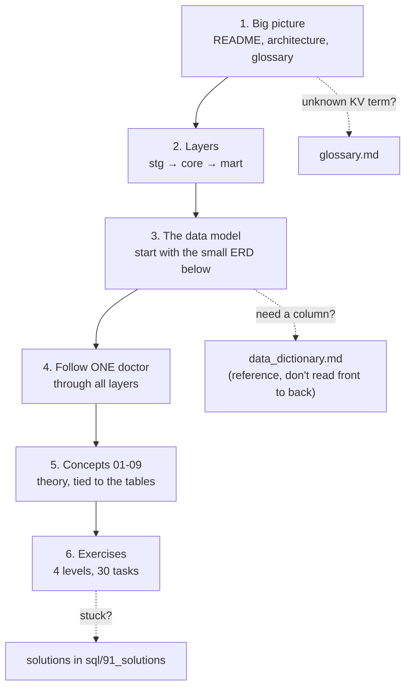
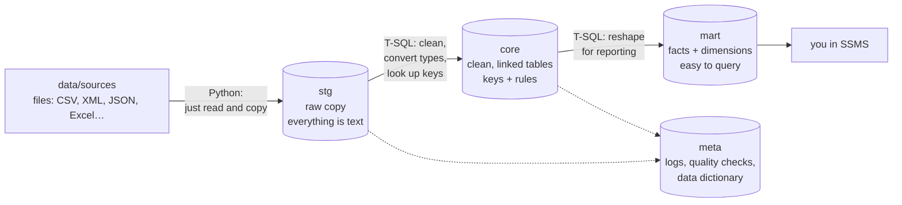
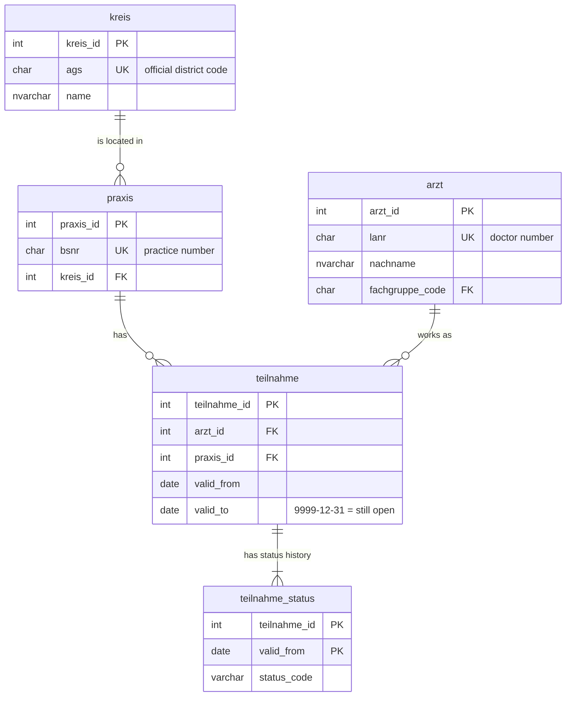
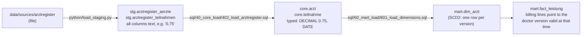
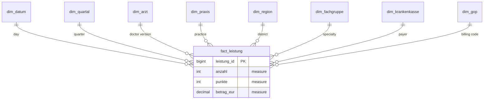
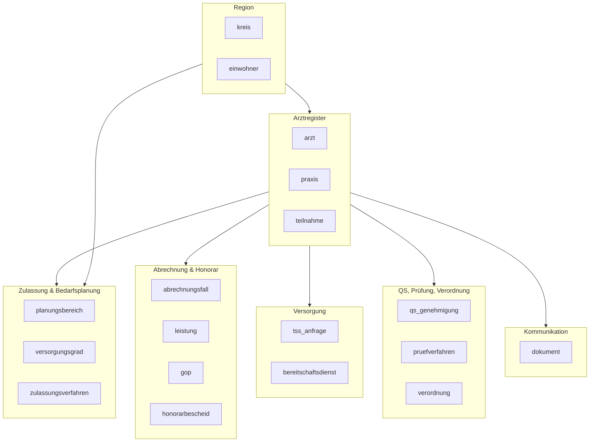

# Reading map - how to get an overview of this project

For SQL beginners. Read top to bottom; each section tells you **what to open**, **what to
look for** and **what to try**. Diagrams are Mermaid (rendered by GitHub and VS Code).

Time needed: about 30 minutes for sections 1-4, then work through section 6 at your own pace.

## 1. The route at a glance



| Step | Open | Goal |
|---|---|---|
| 1 | [README](../README.md), [architecture](architecture.md), [glossary](glossary.md) | know what is simulated and why |
| 2 | [concepts/01](concepts/01_layers_and_elt.md), [sql/README](../sql/README.md) | know what `stg`, `core`, `mart`, `meta` mean |
| 3 | this page (section 3), then [er_diagrams](er_diagrams.md) | see how tables connect |
| 4 | this page (section 4) | see one record travel through the system |
| 5 | [concepts/04](concepts/04_normalization_and_keys.md), [05](concepts/05_history_and_time.md), [07](concepts/07_star_schema_and_scd2.md) first | understand the *why* |
| 6 | [sql/90_exercises](../sql/90_exercises/README.md) | practise |

## 2. The four layers (the one idea to remember)

Data is never fixed in place. It moves through layers, and each layer has **one job**:



Rule of thumb: **ask questions of `mart`** (simple), **understand the business in `core`**
(detailed), **debug in `stg`** (what did the source actually say?).

SQL folder numbers follow this flow: `20_stg` → `30_core` / `40_core_load` →
`50_mart` / `60_mart_load`. In each pair, the first folder **creates tables** and the
second one **fills them**.

## 3. A beginner-sized ERD: the Arztregister core

The full diagrams in [er_diagrams.md](er_diagrams.md) show about 50 tables. Start with
this small excerpt: the four tables you need to answer *"who works where, and since when?"*

**How to read an ERD**

- A box is a **table**. `PK` = primary key (identifies a row), `FK` = foreign key
  (points to a row in another table), `UK` = unique business key.
- A line is a **relationship**. `||--o{` means *one* row on the left relates to
  *zero or many* rows on the right.
- Read it as a sentence: "one `praxis` has zero or many `teilnahme`".



Why `teilnahme` sits **between** `arzt` and `praxis`: a doctor can work in several
practices over time, and a practice has several doctors. That is a *many-to-many*
relationship, and SQL resolves it with a table in the middle that holds one row per
combination (plus the dates). This is the core of [concept 04](concepts/04_normalization_and_keys.md).

Things to notice:

- Each table has a **surrogate key** (`arzt_id`, a plain number) **and** a **business key**
  (`lanr`, the real-world identifier). Joins use the surrogate key; people search by the business key.
- Time is stored as `valid_from` / `valid_to`. The end is **exclusive**, and
  `9999-12-31` means "no end yet" ([concept 05](concepts/05_history_and_time.md)).

## 4. Follow one doctor through every layer

Pick any doctor and watch the same person change shape. The `lanr` is the thread.



What changes at each step (all visible in `402_load_arztregister.sql`):

| Layer | Example of what happens | Where to see it |
|---|---|---|
| `stg` | the factor arrives as the text `'0,75'`, dates as `'15.03.2021'` | `SELECT TOP 20 * FROM stg.arztregister_teilnahmen;` |
| `core` | text becomes `DECIMAL(3,2)` and `DATE`; the empty end date becomes `9999-12-31`; `kreis_ags` is replaced by `kreis_id` (a key lookup) | `SELECT TOP 20 * FROM core.teilnahme;` |
| `mart` | one row per **version** of the doctor, so history is kept for reports | `SELECT TOP 20 * FROM mart.dim_arzt ORDER BY arzt_id, valid_from;` |

Try it yourself (pick any `lanr` from the first query):

```sql
SELECT TOP 5 * FROM core.arzt;

-- one doctor, from the raw text to the clean table
SELECT * FROM stg.arztregister_teilnahmen WHERE lanr = '<your lanr>';
SELECT * FROM core.teilnahme t JOIN core.arzt a ON a.arzt_id = t.arzt_id WHERE a.lanr = '<your lanr>';
SELECT * FROM mart.dim_arzt WHERE arzt_id = <their arzt_id> ORDER BY valid_from;
```

## 5. The reporting side: a star schema

The `mart` layer reshapes the clean data for questions like "points per quarter per
specialty". One central **fact** table (numbers you add up) is surrounded by **dimension**
tables (the things you group and filter by). Drawn out, it looks like a star.



Typical query pattern: join the fact to a few dimensions, `GROUP BY` the dimension
columns, `SUM` the measures. Start with the ready-made view:

```sql
SELECT TOP 20 * FROM mart.v_fallwert_praxis_quartal;
```

Details: [concept 07](concepts/07_star_schema_and_scd2.md) and section 5 of [er_diagrams](er_diagrams.md).

## 6. Where each domain lives (map for lookups)

Use this table when an exercise mentions a topic and you need to know which tables to open.



Arrows mean "is referenced by". `arzt`, `praxis` and `kreis` are the hubs almost every
other domain points to, which is why they are the best place to start. Exact tables per
domain: [architecture.md](architecture.md#domains-and-where-they-live).

## 7. Practise

1. Build the database: `tools\run_all.ps1` (see the [README](../README.md#quick-start)).
2. Do exercise level 01 in [sql/90_exercises](../sql/90_exercises/README.md). Try each task
   first and only then open the same file in `sql/91_solutions`.
3. When you meet an unknown column, look it up in [data_dictionary.md](data_dictionary.md)
   or in SSMS: `SELECT * FROM meta.v_data_dictionary WHERE table_name = 'teilnahme';`
4. When data looks odd, check [assumptions.md](assumptions.md) and
   [data_quality_report.md](data_quality_report.md) before assuming a bug.

Skip on the first pass: [security.md](security.md), full-text search (`85_fulltext`),
[concept 06](concepts/06_indexes_and_plans.md) (indexes and execution plans).
